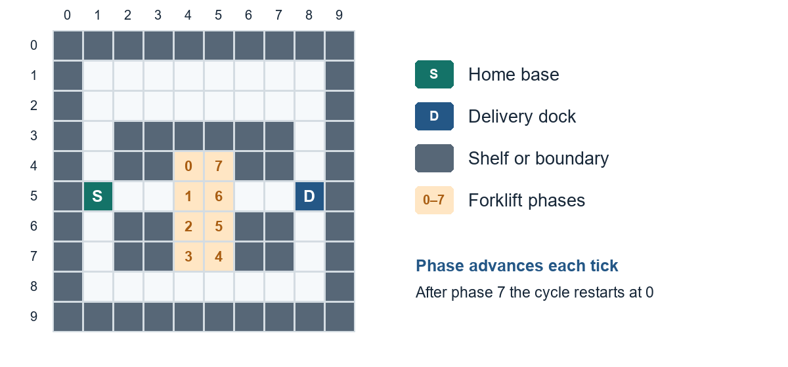
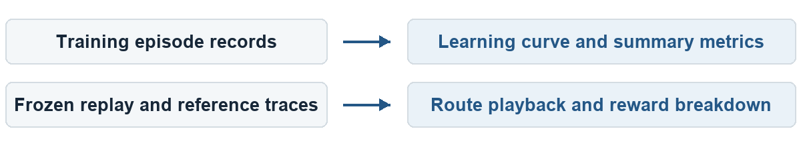
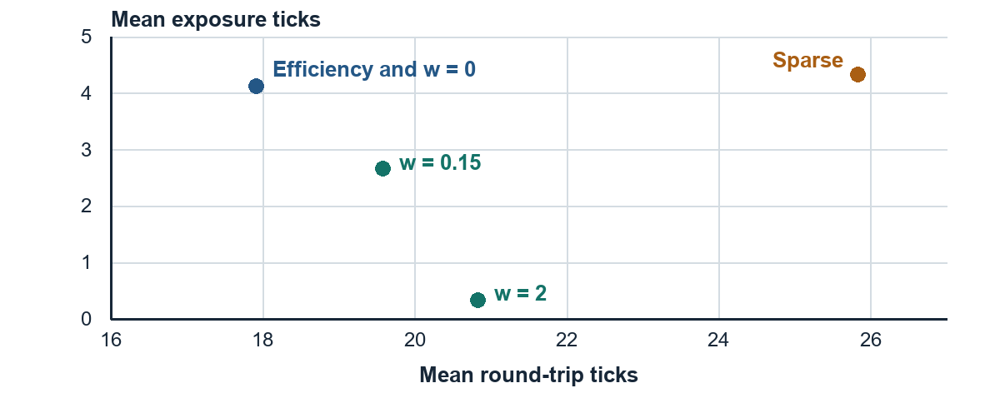

# Abstract

This study asks how reward design affects travel time, energy use and forklift exposure for a simulated warehouse delivery robot. Q-learning was the fastest learner with full completion in the one-way patrol screen. PPO also completed all 24 replays, with zero exposure and longer routes. With Q-learning settings fixed, adding time and energy costs reduced mean round-trip time from 25.83 to 17.92 ticks. Adding a small proximity cost reduced exposure from 4.13 to 2.67 ticks and increased travel time to 19.58 ticks. At that fixed reward, tuning increased minimum-time matches from 2 to 36 of 40 replays on five fresh training seeds, with more exposure. A separate DQN experiment achieved 23 of 24 round trips with both wall-action masking and training-only reward shaping. Shaping alone achieved eight, and masking alone achieved zero. Warehouse RL Lab visualizes the route decisions behind these results. The evidence covers one layout and scripted patrol.

# 1 Research Problem

A warehouse robot must finish a delivery while sharing space with moving traffic. The shortest route on a static map may cross the forklift’s path. A robot can wait for traffic to pass or take a longer aisle to maintain clearance. Both choices use time and energy. The operational question is how much travel time a learned policy gives up to reduce proximity to the forklift, and whether later tuning changes that trade-off.

Warehouse RL Lab visualizes the study results. The learning curve shows how episode returns evolve, while the warehouse animation shows the actions and events behind individual outcomes. A frozen-policy replay and a minimum-time reference can be inspected under the same starting forklift phase. The setup controls let readers reproduce a run for visualization.

## 1.1 Research questions

1. Which learner reliably completes the one-way mission under moving traffic and provides a suitable basis for controlled reward comparisons?
2. With the learner fixed, how do time, energy and proximity costs change completion, travel time, energy use and exposure in a round-trip mission?
3. Once the reward is fixed, how much can targeted tuning reduce travel time on fresh training seeds, and how does it affect forklift exposure?
4. When DQN struggles to learn the round trip, how much do static wall-action masking and training-only progress shaping contribute to completion?

Completion is the first criterion for selecting the learner and judging the tuned policy. Among settings with equal completion, the tuning analysis prioritises minimum-time matches and then mean extra ticks. Exposure is reported as a separate outcome so a faster route can be assessed against its clearance cost.

## 1.2 Scope

The simulation has one delivery robot, one parcel, a fixed warehouse and an optional scripted forklift. Motion takes place in discrete ticks. The experiments measure delivery, travel time, synthetic energy and forklift proximity. Energy is reported in simulation units for comparing routes. Multi-robot traffic, variable layouts, battery depletion and delivery deadlines are possible extensions.

# 2 Background and Related Work

## 2.1 Route planning and reinforcement learning

Breadth-first search finds minimum-length paths when steps have equal cost [1]. A static shortest path shows how direct the floor plan is. A phase-aware search adds the forklift phase and mission leg to calculate a minimum feasible travel time from a known map and patrol. An RL agent improves its action estimates from interaction [2]. Comparing the learned route with the search result reveals where the policy spends extra time for the same starting phase.

Tabular temporal-difference methods are a natural starting point because the observation has few discrete combinations. Q-learning backs up the best estimated next action [3]. SARSA backs up the action selected by the current behaviour policy [2]. That distinction gives a reason to include both. It can affect which routes look attractive during exploration around traffic. Deep Q-learning uses shared weights and can exploit richer observations [4]. In this small problem it introduces an approximation and a training budget requirement that the table avoids.

PPO provides a stochastic-policy comparison for the tabular value methods. It uses a learned value estimate to calculate episode advantages and updates the policy over several passes with a clipped probability-ratio objective [12]. Evaluating both sampled training episodes and greedy replay shows how the policy behaves under those two decision rules.

## 2.2 Reward design and operational constraints

A weighted objective gives each event a cost or benefit. Changing a time or exposure weight changes which behaviours are desirable. Potential-based shaping supplies a training signal based on progress. Ng et al. give conditions under which adding a discounted potential difference preserves the optimal policy [8]. The DQN experiment holds the operational objective fixed, uses zero potential at termination, and measures what the agent learns within a finite training budget.

Exposure counts moments of proximity in the simulator. Collision outcomes, exposure and completion answer different questions. A high proximity penalty can reduce adjacency while increasing delay. A finite penalty permits trade-offs. Operations with mandatory clearance limits would need explicit constraints or a safety mechanism and a corresponding evaluation [9]. Reusing tuning seeds to evaluate the selected configuration can give an overly favourable comparison [10].

# 3 Environment and Exploratory Analysis

## 3.1 Floor plan and mission dynamics

The simulator generates every training record from agent interaction, with no external training dataset. The 10 × 10 map has 46 traversable cells and 54 blocked cells, including the boundary. Coordinates are zero-based in column and row order. The robot starts at (1, 5) and the dock is at (8, 5). The forklift moves along an eight-cell cycle that intersects the central aisle. The upper and lower aisles offer longer routes.

{width="5.75in"}

At each tick the agent selects Up, Right, Down, Left or Wait. A blocked movement leaves the robot in place and still advances time. Valid movement uses one synthetic energy unit. Waiting or blocking uses 0.2. The forklift advances one position on the same tick. Sharing a destination cell or swapping cells causes an immediate collision. An orthogonal distance of one cell after a noncollision transition counts as exposure. Collision takes precedence over delivery. Arrival at the dock automatically drops off the parcel. A round trip then continues to home base, where the success reward is paid once. Successful arrival on tick 100 counts as completion if there is no collision. An unfinished mission on that tick times out.

## 3.2 Observation and exploratory checks

Table: Table 1. State fields available from the simulator and how they support decisions.

| Field | Values in a run | Why it matters |
|------------------|---------------------|---------------------------------------------|
| Robot position | One of 46 traversable cells | Identifies local moves and aisle choices. |
| Forklift phase | 0 to 7, or −1 for a static floor | Determines current and next forklift position. |
| Remaining time | 100 down to 0 ticks | Distinguishes an early state from the same position near the deadline. |
| Mission stage | Outbound or returning | Changes the destination after the parcel is delivered. |

The no-traffic route takes seven ticks outbound and 14 for a round trip. The two aisle detours each take 13 ticks outbound. On the patrol floor the phase-aware round-trip minimum is 14 ticks in five phases and 15 in three. Even the ideal route sometimes needs an extra tick. The planner and replay agreement therefore uses phase-specific minima. Position alone would merge decisions that require different crossing times. Forklift phase and mission stage were retained as explicit fields.

Run settings label each generated record. Static runs leave the patrol phase blank, and non-ε-greedy methods leave ε blank. A blank delivery tick can also indicate a failure before reaching the dock. These fields are retained as recorded to distinguish an inapplicable value from a measurement. Repeated traces remain part of the history because the policy can encounter the same phase several times. Independent training seeds define the splits, and each patrol policy is evaluated at every phase. Phase coverage and seed independence address different kinds of variation.

# 4 Methodology and System Design

## 4.1 Simulation and results visualization

The Python simulator generates transitions and reward components. The agent module selects actions and updates the policy. The experiment records each episode’s outcome, return and operational costs. One random stream drives exploration and tie-breaking. A separate stream selects training phases so runs paired by seed see the same phase sequence even when they take different numbers of steps. The scripted runs produce the multi-seed comparisons reported in Sections 5 and 6.

{width="5.98in"}

The dashboard plots each episode’s operational return, a rolling mean of up to 25 episodes and a zero reference. The warehouse animation shows the robot and forklift positions and the reward components at each tick. The episode grid displays sampled training traces, which can include exploratory actions. In revision f652239, the grid repeats the current recorded group if the next training batch is delayed and plays the final group once. Training and playback pauses let a viewer hold the displayed traces. Frozen replay disables learning and uses greedy choices with seeded tie-breaking. The dashboard reports completion and minimum-time matches over all eight starting phases on the patrol floor and shows an animated replay for one phase. On the static floor, it evaluates one replay.

The reference animation comes from a breadth-first search through position, patrol phase and mission stage. It excludes collisions and timeouts and returns the minimum feasible time for the replayed phase. The dashboard’s CSV records the configuration and per-episode metrics underlying the training views. The project’s Python evaluation interface provides the phase-level results used in the report tables.

These navigation controls and reference rules apply to V0, the environment used for the primary study. The dashboard also offers the V1–V7 pilots in Appendix C. Their previews show pick bays, charging and packing stations, alternate floors, shared aisles, two learning robots, and continuous order fulfillment where applicable. The [warehouse phase log](../research/Warehouse_Phase_Log.md) records each pilot’s learner, evaluation conditions, and reference policy.

## 4.2 From events to training rewards

Every profile awards 100 for completion and deducts 100 for collision or timeout. The efficiency profile also deducts time and energy costs. The operational profile adds a blocked-action cost and allows the user to set the exposure weight w. The logged return is the sum of rewards over the episode. The learning algorithms can discount later rewards, so the learner’s objective and the displayed return need separate interpretation.

Table: Table 2. Operational reward terms and reasons for including them.

| Term | Rule | Intended behaviour |
|----------------|--------------------------|-------------------------------------------|
| Completion | +100 once at successful termination | Finish delivery or the full round trip. |
| Failure | −100 once on collision or timeout | Avoid unsuccessful termination. |
| Time | −0.20 per tick | Reduce unnecessary waiting and long routes. |
| Energy | −0.05 per synthetic unit | Distinguish movement from idling. |
| Exposure | −w per adjacent noncollision tick | Give clearance a measurable value. |
| Blocked move | −1 per attempt | Discourage ineffective actions when permitted. |

A movement tick costs 0.25 in time and energy together, and a wait costs 0.21. At w = 0.15, avoiding one exposure is worth less than adding a wait on these undiscounted terms alone. At w = 2, avoiding one exposure is worth more than nine extra waiting ticks in the same calculation. Zero supplies the removal control. The values bracket distinct incentives and are easy to explain during playback. Actual policies can differ from this one-step accounting because traffic, discounting, completion and the learned value of future actions also matter.

## 4.3 Evaluation design

An episode is a full training interaction sequence. Different policies can generate different numbers of updates within an equal episode budget. We record total transitions and use completion counts with explicit denominators. We report collision and timeout counts separately, then quantify exposure and energy across all replays. Mean completion time and the gap above the search reference use successful replays. A minimum-time match requires both completion and zero gap. Last-25 training completion is a diagnostic of behaviour during training and is reported separately from frozen replay.

The one-way method comparison uses common operational reward settings, paired seeds and a fixed episode budget to select a learner for the round-trip reward study. The Q-learning study then fixes the learner settings and varies the reward. The tuning comparison holds the small exposure cost fixed and tests a higher exposure cost separately. A DQN round-trip ablation uses the same operational reward across four combinations of wall-action masking and shaping. The primary implementation is revision f652239 on the dashboard release branch. Historical baseline results are identified separately [11].

# 5 Learner Selection

## 5.1 Learner suitability and assumptions

Table: Table 3. Suitability and assumptions of the shortlisted learners.

| Learner | Suitability for this study | Assumptions and limits |
|--------------|----------------------------------------|--------------------------------------|
| Q-learning | Inspectable action values suit the small discrete state space and controlled reward comparisons. | Needs repeated visits to relevant positions, forklift phases and mission stages. It pools values across remaining times. |
| SARSA | Tests how the next action chosen during training affects learned routes. | Shares Q-learning’s state key and wall mask. Targets depend on the exploration schedule. |
| DQN | Tests neural value estimation with clock input and progress guidance. | Uses known wall geometry and goal locations. Replay needs useful experience on both mission legs. |
| PPO | A stochastic actor with clipped updates supports evaluation of sampled training and greedy replay. | The state key omits remaining time. Updates depend on episode advantages estimated with a tabular critic. |

For a nonterminal step, the tabular update is Q(s,a) ← Q(s,a) + α[y − Q(s,a)]. Q-learning uses y = r + γ max Q(s′,a′). SARSA uses y = r + γQ(s′,a′) for the chosen successor action. Both use r at termination. The static mask removes wall and boundary moves and retains Wait. Forklift collisions remain possible.

DQN encodes position and phase as indicators and uses the mission stage and normalised remaining time. Its replay targets use a periodically copied network and the same wall-action mask as action selection. Section 6.6 describes its training reward. PPO makes four shuffled update passes over each episode.

## 5.2 Matched conditions

Each method trains independently for 600 one-way episodes per traffic scenario on seeds 42, 43 and 44. The operational exposure cost is 2, which gives clearance enough weight to influence route choice. The comparison pairs scenario sequences and episode counts. Tabular methods use α = 0.25 and initial Q = 0. Value methods start ε at 1 with a floor of 0.05 and decay fraction of 0.80. All learners use γ = 0.98. The screen evaluates complete learner configurations. The move mask, DQN shaping, and access to time are additional differences between configurations, so performance gaps cannot be assigned solely to the update rules.

## 5.3 Outcomes under static and patrol traffic

Table: Table 4. Frozen one-way results for the shortlisted learners using three trained policies per traffic scenario. Failure counts and means refer to patrol. Mean ticks use completed replays.

| Method | Static finish | Patrol finish | Collision | Timeout | Ticks | Exposure | Return |
|-----------------|---------|---------|----------|----------|--------|-----------|-----------|
| Q-learning | 3/3 | 24/24 | 0 | 0 | 9.71 | 0.25 | 97.13 |
| SARSA | 3/3 | 24/24 | 0 | 0 | 17.42 | 0.00 | 95.76 |
| DQN | 3/3 | 23/24 | 1 | 0 | 16.48 | 1.92 | 83.97 |
| PPO | 3/3 | 24/24 | 0 | 0 | 20.67 | 0.00 | 94.35 |

On the static floor all four learners completed all three replays. DQN averaged eight ticks and the other learners took seven. Under patrol, Q-learning averaged 9.71 ticks and 0.25 exposure ticks, while SARSA averaged 17.42 ticks with zero exposure. PPO also achieved zero exposure and averaged 20.67 ticks. Appendix D records the additional screening runs.

## 5.4 Error and feature analysis

The updated DQN completed 23 of 24 patrol replays, compared with six completions in the earlier unshaped and unmasked screen [11]. Section 6.6 tests both changes individually on the round-trip mission. PPO completed all 75 late sampled patrol episodes across the three seeds and all 24 frozen patrol replays. The two measures evaluate the sampled and greedy policies under their respective conditions.

## 5.5 Shortlist and decision

Q-learning advances to the reward and tuning study because it was quickest among learners with full patrol completion. SARSA provides the matched comparison for the effect of the tabular update rule. PPO covers stochastic policy learning, while the separate DQN ablation evaluates the contributions of wall-action masking and progress shaping.

# 6 Reward Design and Learner Tuning

## 6.1 Reward study with fixed learner settings

The reward study tests whether explicit costs reduce delay, energy use and forklift proximity before changing any learner settings. All rows use Q-learning with 1,500 round-trip patrol episodes per seed, α = 0.25, γ = 0.98, minimum ε = 0.05, decay fraction 0.80 and initial Q = 0. The budget matches the later tuning comparison and gives each reward profile the same number of training episodes. The validation seeds are 7, 19 and 42. The same policy and environment interfaces are used throughout. Each seed’s trained policy is replayed on all eight starting phases.

Table: Table 5. Paired reward ablation at fixed learner settings. Every row completed 24 of 24 frozen replays, with zero collisions and zero timeouts. Energy and exposure are per replay.

| Reward | Fastest | Mean ticks | Exposure | Energy | Training transitions |
|----------------------|----------|------------|-----------|-----------|------------------|
| Sparse | 0/24 | 25.83 | 4.33 | 20.17 | 93,461 |
| Efficiency | 4/24 | 17.92 | 4.13 | 15.32 | 59,837 |
| Operational w = 0 | 4/24 | 17.92 | 4.13 | 15.32 | 59,837 |
| Operational w = 0.15 | 2/24 | 19.58 | 2.67 | 16.78 | 64,393 |
| Operational w = 2 | 0/24 | 20.83 | 0.33 | 17.50 | 67,399 |

Adding time and energy costs to sparse rewards cut mean completion time by 7.92 ticks and mean energy by 4.85 units. Mean waits fell from 7.08 to 3.25. Under sparse rewards, discounting provides an implicit incentive to reach the positive terminal reward sooner. The explicit efficiency terms put an additional cost on the steps along the route. The experiment introduced time and energy costs together, so the measured change applies to the pair.

The efficiency and zero-exposure operational runs produced identical measured behaviour under pairing. Every blocked-action count was zero because Q-learning’s move mask excludes blocked commands. The blocked-action term can affect learners that can attempt those moves. Testing it separately would require a fixed action set that includes blocked commands.

The w = 0.15 condition traded 1.67 ticks for 1.46 fewer exposure ticks relative to efficiency. At w = 2, exposure fell to 0.33 ticks and mean time increased to 20.83. Figure 3 shows the observed time and exposure trade-off. The speed-focused tuning comparison uses w = 0.15 because it retains a clearance incentive at a smaller time cost. The w = 2 setting tests how the tuned learner behaves when clearance carries more weight. Displayed return differs in meaning across objectives, so the decision uses the common operational measures.

{width="5.98in"}

## 6.2 Tuning direction and selection rules

The reward ablation motivates fixing the clearance weight for the before-and-after comparison. The recorded search ranked configurations by completed missions, minimum-time matches and mean extra ticks, in that order. Table 6 ties each search range to a plausible source of delay or inefficient exploration. The fresh-seed comparison tests the selected settings with the reward held fixed.

Table: Table 6. Candidate directions from the recorded sweeps and their rationale.

| Setting | Explored values or range | Direction and reason |
|----------------|---------------------|-----------------------------------------------|
| Episode budget | 600 to 1,800 | Longer runs give more visits to rare phase and mission-stage combinations. Matching the budget later isolates changes to the learner. |
| Learning rate α | 0.25 to 1 | Deterministic transitions motivate testing stronger updates. Bootstrapped estimates and shared time states can still amplify errors. |
| Discount γ | 0.80 to 0.98 | A lower value makes prompt completion matter more. Very short effective horizons can weaken credit from the return leg. |
| Minimum ε | 0.02 to 0.12 | Retain a way to sample alternatives while avoiding excessive late random choices near the crossing. |
| Decay fraction | 0.25 to 0.95 | Early decay can lock in a workable detour. Slower decay gives the agent more chances to try other crossings. |
| Initial Q | 0 or 100 | Initialising at the completion reward gives unvisited moves optimistic values relative to known costly moves. |

The recorded final neighbourhood crossed 1,200, 1,500 and 1,800 episodes with γ at 0.80, 0.85 and 0.90 and w at 0.15, 0.25 and 0.50. It held α = 1, initial Q = 100, ε floor = 0.02 and decay fraction = 0.85 fixed. The budget brackets available training time, the γ points probe the shorter-horizon region, and the cost values test light clearance incentives around the cost of one additional wait or move. The historical grid tested local interactions among these factors. The fixed-objective comparison here uses w = 0.15 to estimate the effect of the tuning bundle. An initial-Q ablation then isolates one part of that bundle.

The selected bundle is 1,500 episodes, α = 1, γ = 0.85, ε floor = 0.02, decay fraction = 0.85, initial Q = 100 and operational w = 0.15. In training, ε at episode e is the larger of its floor and 1 − (e − 1) / max(1, (N − 1) × decay fraction). The historical validation achieved 24 minimum-time matches from 24 replays. Those seeds guide selection, so fresh training seeds supply the confirmation.

## 6.3 Planning reference for evaluation

Frozen replay preserves every action selected by the trained policy. The planner provides a separate reference for the same starting phase. Comparing the two trajectories shows where the policy waits or takes a longer path. The evaluation uses the time difference and counts a minimum-time match only when the policy completes the mission at the reference time.

## 6.4 Before and after on fresh training seeds

The confirmation uses seeds 617, 719, 823, 929 and 1031. All are separate from the historical tuning and verification seeds. Each configuration trains for 1,500 episodes and is replayed in eight phases per seed. The main before-and-after comparison fixes the operational w = 0.15 and changes the training settings. Two one-factor comparisons then isolate the effects of initial Q and the exposure weight.

Table: Table 7. Fresh-seed frozen round-trip results. Each row completed 40 of 40 replays, with zero collisions and zero timeouts.

| Configuration | Fastest | Mean ticks | Extra ticks | Exposure | Energy |
|-------------------------|---------|------------|------------|-------------|-------------|
| Baseline w = 0.15 | 2/40 | 18.900 | 4.525 | 1.33 | 16.86 |
| Tuned w = 0.15 | 36/40 | 14.550 | 0.175 | 3.50 | 14.11 |
| Tuned with initial Q = 0 | 0/40 | 19.700 | 5.325 | 0.05 | 15.14 |
| Tuned w = 2 | 25/40 | 14.925 | 0.550 | 2.15 | 14.19 |

Tuning at the same reward reduced mean time from 18.90 to 14.55 ticks and raised minimum-time matches from 2 to 36. The mean number of training transitions fell from about 62,061 to 52,868 per seed at the same episode budget. Those totals measure interaction cost at the end of the run. Mean exposure rose by 2.175 ticks, a cost that matters when clearance is part of the navigation objective.

Removing optimistic initialisation dropped minimum-time matches to 0 of 40 and increased average waits from 0.55 to 5.70. Optimism can encourage trials of actions whose values have yet to be reduced by experience. Visit counts would help test that explanation for the measured difference. Increasing only exposure cost to 2 reduced mean exposure from 3.50 to 2.15 at a cost of 0.375 ticks and 11 fewer minimum-time matches. That direction agrees with the fixed-learner reward study.

{width="5.98in"}

During episodes 801 to 900, the tuned bundle completed 65% of training episodes versus 45% for the baseline. In the final 100 episodes, the corresponding rates were 99.4% and 94.8%. These values combine the effects of update settings and exploration on sampled behaviour. Frozen replay fixes exploration at zero and tests every phase equally.

## 6.5 Robustness and scope of the evidence

The recorded verification seeds 103, 211, 307, 409 and 503 reproduced 37 fastest replays out of 40 for the selected settings. Fresh-seed fastest counts were 6, 8, 8, 6 and 8 out of eight. Completion reached eight in each of those seeds. A seed changes the learned policy and phase order in training. The eight phase replays share one policy per seed, so they are repeated measurements of that trained policy. The simulator has a single geometry and one periodic forklift. This evidence supports repeatability under different training seeds on that scenario. Generalisation requires changing the environment.

For the masked table, the patrol state key has at most 46 × 8 × 2 = 736 entries in a round trip, each storing five action scores. The implementation stores entries as they are visited. Adding explicit time would multiply the potential state keys by about 100. Map variants or extra forklifts would increase the number of possible states further and could justify richer representations. The current evaluation script runs every phase for each trained policy, making paired comparisons repeatable.

## 6.6 DQN progress shaping and wall-action masking

The baseline DQN completed no round trips in this comparison, so the terminal success reward provided little direct feedback about progress toward the dock and back. The updated learner adds γΦ(s′) − Φ(s) to each training reward before scaling by 100. The potential Φ is −10 times the remaining Manhattan distance through the mission goals and is zero at every terminal state. The factor of 10 makes each unit of geometric progress substantial relative to the operational tick cost. The distance is a coarse guide that supplies no forklift timing or collision information. The wall-action mask removes known invalid moves and retains Wait. The dashboard and evaluation report the original operational rewards.

The four combinations below isolate the contributions at the tested settings. Every condition used 1,500 patrol round-trip training episodes, seeds 42–44, exposure cost 0.15, γ = 0.98, an exploration floor of 0.05 and a decay fraction of 0.80. Each trained policy was replayed greedily from all eight starting phases.

Table: Table 8. DQN round-trip ablation with both factors toggled at a common operational reward.

| DQN configuration | Completed | Collisions | Timeouts | Mean ticks on completion | Minimum-time matches |
|---------------------|-------------|------------|------------|----------------------|--------------------|
| Base DQN | 0/24 | 0 | 24 | — | 0/24 |
| Wall-action mask | 0/24 | 0 | 24 | — | 0/24 |
| Progress shaping | 8/24 | 3 | 13 | 37.50 | 0/24 |
| Mask and shaping | 23/24 | 1 | 0 | 27.43 | 1/24 |

Masking alone eliminated blocked commands but did not yield a completed replay. Shaping alone yielded eight completions, all from seed 44. Adding the mask to shaping yielded 8, 7 and 8 completions across the three seeds. That combination gave the most consistent completion in this study, with one collision and one minimum-time match. The representative replay for seed 42 and phase 6 reached the dock at tick 19 and returned at tick 27. The collision-free reference for that phase took 15 ticks. These results support progress guidance for this DQN configuration and show why delivery reliability and route efficiency need separate measures.

# 7 Results Evaluation and Discussion

## 7.1 Route behaviour and measured tradeoffs

On fresh seed 617 and phase 5, the tuned w = 0.15 route uses 14 ticks, zero waits and six exposure ticks. The same learner at w = 2 takes 17 ticks, with three waits and zero exposure. Both complete. This example shows a concrete way that waiting changes clearance. On the same seed in phase 0, the higher-cost route also happens to be faster than the low-cost version, completing in 14 ticks instead of 16. That phase cautions against applying a mean trade-off to every trace. Playback and the reward log help locate the decision.

The 14.55-tick result at light exposure cost is close to the mean phase-specific reference of 14.375 ticks. That reference minimises time under the simulator’s constraints. The additional measures of exposure and energy show what achieving that time costs. At phase 5, the higher exposure weight produces three waits and eliminates adjacency in the replay. Looking at the route alongside the metrics makes that difference visible.

## 7.2 Visual presentation of the results

The learning curve shows variability across episodes and the direction of the return trend within a run. Its vertical scale depends on the selected reward. The common measures in Figure 3 and Table 5 therefore support comparisons across reward profiles. The episode grid shows examples of sampled training behaviour, while frozen replay shows the trained policy’s decisions under the evaluation rules.

The route animation and per-step reward breakdown connect a measured result to a specific action. A wait appears as a stationary robot with a time cost and lower energy use for that tick. The forklift continues moving, so the viewer can see whether the wait changes clearance on the next move. The displayed minimum-time route gives a direct comparison for the same starting phase. The aggregate tables show how representative an illustrated route is across phases and seeds.

A local browser smoke check exercised Q-learning and PPO training and frozen replays. It also delayed a DQN training batch and checked that the recorded grid group continued playing, that both pause controls held playback, and that the final group stopped at its last frame. This check verifies playback behaviour independently of policy performance.

## 7.3 Threats to interpretation

The primary Q-learning reward experiments group time and energy in the efficiency profile. A [follow-up on revision `f05a308`](../research/Warehouse_Reward_Design_Research.md#round-trip-reward-experiments-november-20-2026) varied the two costs separately at two bundles of learner settings. At the report's baseline settings, the time cost shortened trips and the energy cost reduced energy use. At the tuned dashboard settings, the sparse reward already matched all 40 reference times in that seed set. These results depend on the learner settings and the fixed floor and patrol. The blocked-action penalty cannot act on a masked policy. The DQN ablation toggles whether invalid actions are available, while a separate test with blocked commands available would be needed to measure the blocked-action penalty itself. Equal episode budgets can also give different interaction budgets. A transition-matched run, with separately reported runtime, could test sample efficiency more directly.

Aggregate outcomes are descriptive across trained seeds and deterministic start phases. The same eight phases may appear in training. Exposure counts adjacent ticks and can fall when a policy fails early or stays away from the crossing. Reporting it alongside completion and failure types reduces that ambiguity. Static route knowledge favours the structured baseline, while the short horizon and explicit phase observation simplify the problem for tabular methods. A physical warehouse would require a validated environment and a different safety evaluation.

# 8 Conclusion and Future Work

For the tested warehouse and forklift patrol, time and energy costs shortened Q-learning routes and higher exposure costs reduced forklift proximity. Tuning the learner at a fixed reward then shortened travel time further on fresh seeds, with greater exposure. Q-learning remains the basis of the reward study because it had the shortest mean time among learners that completed every one-way patrol replay. PPO completed every one-way patrol replay with zero exposure and took longer. For DQN, the combined shaping and masking improved round-trip completion, and the phase-specific planner showed that most successful routes still took extra time. The dashboard makes these differences visible through recorded actions, per-tick operational rewards and the reference route.

The next study should add held-out patrol schedules or layouts and evaluate policies using the same operational metrics. A results view that places paired replays side by side for the same phase would make those comparisons easier to inspect. A follow-up could test an explicit exposure or energy constraint and assess whether DQN’s progress guidance remains effective on those new scenarios.

# References

[1] Cormen, T. H., Leiserson, C. E., Rivest, R. L., & Stein, C. (2022). Introduction to Algorithms (4th ed.). MIT Press.

[2] Sutton, R. S., & Barto, A. G. (2018). Reinforcement Learning: An Introduction (2nd ed.). MIT Press.

[3] Watkins, C. J. C. H., & Dayan, P. (1992). Q-learning. Machine Learning, 8, 279–292. doi:10.1007/BF00992698

[4] Mnih, V., et al. (2015). Human-level control through deep reinforcement learning. Nature, 518, 529–533. doi:10.1038/nature14236

[5] Williams, R. J. (1992). Simple statistical gradient-following algorithms for connectionist reinforcement learning. Machine Learning, 8, 229–256. doi:10.1007/BF00992696

[6] Konda, V. R., & Tsitsiklis, J. N. (1999). Actor-critic algorithms. Advances in Neural Information Processing Systems, 12.

[7] Garivier, A., Lattimore, T., & Kaufmann, E. (2016). On Explore-Then-Commit strategies. Advances in Neural Information Processing Systems, 29.

[8] Ng, A. Y., Harada, D., & Russell, S. J. (1999). Policy invariance under reward transformations: Theory and application to reward shaping. Proceedings of the 16th International Conference on Machine Learning, 278–287.

[9] Achiam, J., Held, D., Tamar, A., & Abbeel, P. (2017). Constrained policy optimization. Proceedings of Machine Learning Research, 70, 22–31.

[10] Eimer, T., Lindauer, M., & Raileanu, R. (2023). Hyperparameters in reinforcement learning and how to tune them. Proceedings of Machine Learning Research, 202.

[11] Warehouse RL Lab project repository. (2026). Warehouse environment, agent source, algorithm comparison and reward-design research. Historical revision f05a308 and dashboard release revision f652239.

[12] Schulman, J., Wolski, F., Dhariwal, P., Radford, A., & Klimov, O. (2017). Proximal policy optimization algorithms. arXiv:1707.06347.

# Appendices

## Appendix A Reproduction guide

The result tables were checked using Python 3.14.6 on Windows against f652239, the 19 November 2026 dashboard release revision on `codex/dashboard-publish`. To open that dashboard locally, run `python app.py --port 0` from a checkout of the revision and open the printed address. The following script reproduces the fresh-seed evaluation for Table 7. Run it from a Python file in that checkout. Each condition is trained from its own initial state.

```python
from statistics import mean
from warehouse import TrainingRun

seeds = (617, 719, 823, 929, 1031)
baseline = dict(alpha=0.25, gamma=0.98, epsilon_min=0.05,
                decay_fraction=0.80, initial_q=0)
tuned = dict(alpha=1, gamma=0.85, epsilon_min=0.02,
             decay_fraction=0.85, initial_q=100)
variants = (
    ("Baseline", baseline, 0.15),
    ("Tuned", tuned, 0.15),
    ("Zero initial Q", {**tuned, "initial_q": 0}, 0.15),
    ("High exposure cost", tuned, 2),
)
for label, settings, weight in variants:
    replays = []
    for seed in seeds:
        run = TrainingRun(
            episodes=1500, seed=seed, algorithm="q_learning",
            profile="balanced", exposure_cost=weight,
            traffic="patrol", round_trip=True, **settings
        )
        while len(run.history) < run.total:
            run.advance(10)
        replays.extend(run.evaluate())
    completed = [row for row in replays if row["outcome"] == "returned"]
    gaps = [row["steps"] - row["optimal_steps"] for row in completed]
    print(label, len(completed), gaps.count(0), mean(gaps),
          mean(row["exposures"] for row in replays))
```

For Table 5, use validation seeds 7, 19 and 42 with the baseline settings. Run the `sparse` and `efficiency` profiles with exposure cost 0, then use `balanced` with costs 0, 0.15 and 2. For the historical verification, substitute seeds 103, 211, 307, 409 and 503. For Table 4, use one-way missions, 600 episodes, seeds 42–44, both traffic options (`none` and `patrol`), and `balanced` at 2. Pass the baseline settings explicitly for Q-learning and SARSA. The other methods use the defaults listed in Appendix B. For Table 8, use the DQN factory from the release revision. In the mask-off conditions pass all five actions at each cell. In the shaping-off conditions pass a potential that returns zero. Keep the other DQN and simulator settings fixed. The result fields are `outcome`, `steps`, `optimal_steps`, `energy`, `exposures`, `blocked`, `waits` and `reward`.

## Appendix B Method settings and historical verification

Table: Table 9. Settings specific to the supplementary methods in the one-way screen.

| Method | Settings |
|-------------------|-----------------------------------------------------------------|
| DQN | Two hidden layers with 16 units each. Huber loss and SGD at 0.015. Replay capacity 5,000, warm-up 128 transitions, four samples every four transitions, target copy every 250 transitions. Static action masking and potential-based shaping. |
| REINFORCE | Actor step size 0.12. Running scalar baseline step size 0.05. Episode-level discounted returns. |
| Actor–Critic | Actor step size 0.25 and critic step size 0.2. One-step temporal-difference update. |
| PPO | Actor step size 0.25 and critic step size 0.2. Advantage parameter λ = 0.95, clip threshold 0.20 and four shuffled update passes per episode. |

DQN divides its shaped training reward by 100. REINFORCE, Actor–Critic and PPO divide the operational reward by 100 for training. Replay statistics use the original operational units. Frozen runs start with a seeded tie-breaking stream. The static case uses one replay per seed. The patrol case uses phases 0 to 7 once each.

Table: Table 10. Historical verification reproduced on seeds 103, 211, 307, 409 and 503. Every row completed all 40 replays with zero collisions and zero timeouts.

| Configuration | Fastest | Mean ticks | Extra ticks | Exposure | Energy |
|-------------------------|---------|------------|------------|-------------|-------------|
| Baseline w = 0.15 | 1/40 | 19.100 | 4.725 | 1.70 | 16.26 |
| Tuned w = 0.15 | 37/40 | 14.500 | 0.125 | 3.40 | 14.10 |
| Tuned with initial Q = 0 | 4/40 | 17.150 | 2.775 | 1.83 | 14.63 |
| Tuned w = 2 | 27/40 | 14.700 | 0.325 | 2.50 | 14.14 |

## Appendix C Experiment record

Table: Table 11. Experiment milestones and the evidence each contributes.

| Milestone | Paired conditions | Main observation |
|------------------|--------------------------|----------------------------------------|
| One-way method screen | 3 seeds, 2 traffic modes and 600 episodes per run | Q-learning is fastest among fully completing learners. PPO completes every patrol replay with zero exposure. |
| Round-trip reward ablation | 3 seeds, 5 reward conditions and 1,500 episodes per run | Efficiency reduces delay and energy. Exposure cost trades time for clearance. |
| Historical configuration verification | 5 seeds and 1,500 episodes per run | Tuned light-cost setting reproduces 37 fastest matches in 40. |
| Fresh before-and-after check | 5 new seeds, 4 configurations and 1,500 episodes per run | Fastest matches improve from 2 to 36 in the fixed-reward comparison, with higher exposure. |
| DQN reward guidance | 3 seeds, 4 mask and shaping combinations and 1,500 episodes per run | Combined masking and shaping complete 23 of 24 replays. Shaping alone completes eight. |

Regenerate the affected tables and figures if the simulator transitions, reward coefficients or learner defaults change. A revised warehouse layout or patrol needs its own phase-aware reference and evaluation before its metrics are compared.

The following pilots use different workflows and evaluation conditions from the V0 reward study. Their results are preliminary and apply to the configurations recorded in the [warehouse phase log](../research/Warehouse_Phase_Log.md). The dashboard previews and reference replays let viewers inspect the corresponding layouts, actions and operational metrics.

### Stocked-rack pilot

The V1 prototype adds two stocked pick bays to the existing 10 × 10 floor. The robot starts with an empty tote and receives an order for a carton or a refill pack. A one-tick wait at the assigned bay loads the item. Entering the dock with that item completes the order. The tabular policy distinguishes the requested item and tote contents, while the reward credits completion at the dock. The dashboard shows pickup, rack stock and delivery during replay.

The static pilot trained Q-learning for 1,500 episodes with each of seeds 42, 43 and 44 using the operational reward. Each frozen policy completed both order types in the planner's minimum of 14 ticks, consisting of 13 movement ticks and one pickup tick. Each delivery consumed 13.2 simulation energy units. The two orders use fixed rack locations in one layout. The original reward comparisons use the navigation mission described in Section 3.

### Charging-dock pilot

V2 uses the start cell as a charging dock and adds remaining battery charge to the observation. A full battery starts at 14 synthetic units, while a low battery starts at 12. Waiting at the charger adds one net unit per tick up to capacity. Battery depletion away from the charger ends the mission. The reference completes both orders in 14 ticks from full charge and 16 ticks from low charge. The dashboard shows charge and charging waits alongside pickup and delivery.

On seeds 42–44, Q-learning trained from scratch on V2 for 3,000 episodes completed none of the 12 frozen evaluations across both orders and both starting charges. A warm start trained for 1,500 episodes on V1, transferred the tabular action values by order and tote state, then trained for 1,500 episodes on V2. It matched the planner in all 12 evaluations. An extended scratch run of 4,200 episodes exceeded the warm-start interaction count for each seed and also completed none of its 12 evaluations. The protocol uses fixed orders and battery presets on one static layout. The warm-start runs completed 891 of 4,500 exploratory V2 episodes.

### Packing and staging pilot

V3 adds a staffed packing station next to outbound staging. The robot collects the requested item, waits one tick at the station and moves the packed carton into staging. The observation records completion of packing, and only staging the packed carton earns the delivery reward. The fastest route draws 15.4 simulation energy units. The full and low battery presets start at 16 and 14 units. The planner completes either order in 17 ticks from full charge and 19 ticks from low charge.

Q-learning used 1,500 episodes of packing practice without battery limits and 1,500 episodes with battery limits for each of seeds 42–44. The frozen policies matched the planner on all 12 evaluations across both orders and charge presets. They completed 740 of 4,500 exploratory V3 episodes. The 3,000-episode scratch runs completed none of the 12 frozen evaluations. The 4,400-episode scratch runs also completed none, despite exceeding the warm-start simulator tick count for each seed. This pilot evaluates one static layout and fixed orders. The dashboard shows pickup, packing and staging in the replay and records the packing tick in the episode export.

### Multiple-layout pilot

V4 tests whether a robot trained on multiple floors completes more orders on a reserved floor. The three synthetic 10 × 10 layouts keep the V3 battery limits and the same pickup, packing and staging rules. The comparison trains a DQN on either the original floor alone or a mix of the original floor and a parallel-aisle floor. The offset cross-aisle remains held out in both conditions. Station-distance and movement-mask inputs let a shared network act on each layout using its geometry, along with charge, time and order progress. Both conditions use guided exploration and a training-only reward term based on estimated remaining ticks. The dashboard displays the operational reward, the selected floor and the outcome against a minimum-time simulator reference.

Each condition used 1,500 episodes with the operational reward for each of seeds 42–44. Frozen evaluation covered both orders and both charge presets per seed on each floor. On the offset cross-aisle, mixed training completed 12 of 12 trials and matched the reference in 10. Original-only training completed 8 of 12 and matched the reference in 4. The four failed trials ended in battery depletion. Both conditions completed all 12 trials on the original floor, with 11 minimum-time matches for original-only training and 10 for mixed training. On the parallel-aisle floor, mixed training completed all 12 trials at the minimum time, while original-only training completed 6 at the minimum time.

Original-only runs used 41,540–58,129 simulator ticks per seed and mixed runs used 41,648–52,476. The comparison holds the episode budget fixed. The frozen policies can use the held-out geometry through their distance features. The results describe this reserved layout and this guided DQN configuration. A guide-only control and further reserved layouts would help quantify the contribution of learned action selection.

### Shared-aisle pilot

V5 adds a scripted replenishment AMR to the original packing floor. It carries a tote from parking to a buffer bay and returns. Both robots submit movement requests before a joint update. The controller gives replenishment priority for a contested free cell, prevents head-on swaps and admits followers only when the cell is vacated. The learning AMR observes which requests would cause either robot to be denied. Replays report both denials and stall ticks, defined as conflict ticks in which neither robot moves. Shipment credit still requires staging the packed order.

The pilot trained a traffic-aware DQN for 1,500 episodes per seed on seeds 42–44 and compared it with the frozen V4 original-floor policy. Each policy faced two orders, two starting charges and two release times for the scripted AMR. V5 completed 24 of 24 shipments and matched the minimum-time reference in 19. The V4 control completed 22 and matched the reference in 20. Both control failures depleted the battery. The evaluated V5 policies accumulated 10 stall ticks, compared with five for the control. Replenishment finished and the scripted AMR returned to parking in every frozen trial. The reference completed every case in 17 or 19 ticks, depending on starting charge.

The pilot varies training traffic, traffic inputs and guided exploration together. It uses one scripted route and two known release times on one floor. The deterministic controller prevents contact in both conditions. The measured differences concern completion and delay under that controller. The dashboard supports inspecting each conflict rule and exporting the denial counts.

### Two-learning-robot pilot

V6 replaces the scripted replenishment robot with a second learning AMR. The two robots each receive one stocked item and start at separate chargers. They share picking aisles, packing and outbound staging. V5's joint movement rules still apply, with AMR 2 receiving priority for a contested free cell. Handing off a packed order earns the team 50 points and frees the staging cell on the following tick. The episode ends when both orders are staged, a battery depletes or the time limit is reached. The dashboard shows each robot's actions, charge, stationary ticks and denied moves.

Independent PPO and multi-agent PPO use the same local action features and team reward. The two conditions differ in critic inputs. IPPO uses each robot's features for its own value estimate. MAPPO uses both robots' features in a shared critic during training. Both methods initialize the actors to favor waypoint progress and compare against those initial policies. The centralized joint A* reference completes the eight order and charge combinations in 17–22 ticks.

Each method trained for 1,500 episodes per seed on seeds 42–44. With four frozen sampled replays per scenario and seed, both finished both orders in 86 of 96 trials. The initialized actor finished 74. IPPO matched the minimum time 33 times and accumulated 107 stall ticks. MAPPO matched it 32 times and accumulated 141 stall ticks. The initialized actor matched it 18 times and accumulated 359 stall ticks. Both trained methods staged 180 of 192 individual orders. Under highest-probability action selection, both methods finished 12 of 24 trials. The other 12 repeatedly requested opposing moves and eventually depleted a battery. The one-floor pilot uses known scenario combinations and gives no clear advantage to the centralized critic.

### Continuous fulfillment pilot

V7 releases six paced orders or twelve burst orders over an 80-tick shift. The dispatcher reserves rack stock when an AMR accepts an order at its charger. The robot collects the item, joins the FIFO queue in a marked waiting bay, uses the single packing slot for three ticks, and stages the carton. It then returns to its charger and can take another order. The dashboard shows each reservation, queue position, packing time and outstanding order. End backlog includes every released order that has yet to reach staging.

The pilot used the V6 PPO settings, with identical 120,000-tick training budgets for IPPO and MAPPO on each of seeds 42–44. Across 24 frozen sampled shifts per workload, IPPO averaged 3.50 and 3.58 staged orders per paced and burst shift. MAPPO averaged 3.63 and 3.54. The initialized actor averaged 2.17 and 2.46. A centralized dispatch heuristic staged four orders in each case, leaving two paced and eight burst orders in backlog. Its mean queue time summed across jobs was 8.50 ticks. Burst IPPO and MAPPO averaged 6.58 and 7.17 queue ticks, and 8.42 and 8.46 orders in end backlog. Both trained policies averaged 1.50 staged orders per shift when replay selected only the highest-probability actions. The pilot uses synthetic workload schedules, and the centralized heuristic supplies a repeatable comparison within the simulator.

## Appendix D Additional learner screening results

The broader screen also tested tabular one-step Actor–Critic and REINFORCE under the one-way protocol in Section 5.2. Both used the same five actions as PPO.

Table: Table 12. Additional one-way frozen replays. Failure counts and means refer to patrol. Mean ticks use completed replays.

| Method | Static finish | Patrol finish | Collision | Timeout | Ticks | Exposure | Return |
|-----------------|---------|---------|----------|----------|--------|-----------|-----------|
| Actor–Critic | 3/3 | 24/24 | 0 | 0 | 19.21 | 0.38 | 93.67 |
| REINFORCE | 3/3 | 0/24 | 0 | 24 | — | 0.00 | -142.28 |

Actor–Critic shares PPO’s softmax actor and tabular critic and updates from a one-step value estimate [6]. Its frozen patrol policy completed every replay, while its sampled policy completed five of the final 75 training episodes. Those results give a diagnostic comparison for PPO. Including both in the primary study would be useful for a separate question about policy update design. REINFORCE uses sampled episode returns and a scalar baseline [5]. It failed to complete any patrol replay at the tested settings, so the study did not carry it forward.

A historical Explore-Then-Commit baseline chose among three map-derived routes and completed all 24 patrol replays in 13 ticks with zero exposure [7, 11]. The precomputed routes supplied a different source of prior knowledge. The main study uses the phase-aware planner as its route reference.
